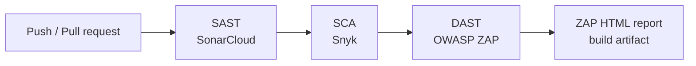

# DevSecOps Pipeline: SAST, SCA and DAST End-to-End

[](https://github.com/bytedawgdevops/devsecops-gitlab-end2End-sast-sca-dast-repo-main/actions/workflows/devsecops.yml)

An automated security pipeline that scans a Java (Maven) application in three stages on every push:

1. **SAST**: static code analysis with **SonarCloud**
2. **SCA**: open-source dependency scanning with **Snyk**
3. **DAST**: dynamic testing of a running web app with **OWASP ZAP**

The pipeline runs on **GitHub Actions**, and an equivalent **GitLab CI/CD** version is included. The goal is to show "shift-left" security: catching code flaws, vulnerable libraries and runtime weaknesses automatically, before anything reaches production.

---

## Pipeline overview



The stages run in order, and each one only starts if the previous one succeeded.

| Stage | Tool | What it checks | Where results appear |
|---|---|---|---|
| SAST | SonarCloud | Bugs, code smells, security hotspots and vulnerabilities in the source code | SonarCloud project dashboard |
| SCA | Snyk (Maven plugin) | Known CVEs in third-party dependencies declared in `pom.xml` | GitHub Actions job log |
| DAST | OWASP ZAP 2.16.0 | Runtime vulnerabilities (XSS, missing security headers, injection and more) found by spidering and actively scanning a live app | `zap-report` artifact on the workflow run |

### DAST target

To avoid scanning any real website without permission, the DAST stage starts **[OWASP Juice Shop](https://owasp.org/www-project-juice-shop/)**, a deliberately vulnerable practice app, as a service container *inside the GitHub runner*. ZAP scans it at `http://localhost:3000`, so all traffic stays inside the pipeline.

---

## Repository structure

```
.
├── .github/
│   └── workflows/
│       └── devsecops.yml   # GitHub Actions pipeline
├── .gitlab-ci.yml          # Equivalent GitLab CI/CD pipeline
├── pom.xml                 # Maven build, including the Snyk plugin
└── ...                     # Java application source
```

---

## Setup

### 1. Fork or clone the repository

```bash
git clone https://github.com/bytedawgdevops/devsecops-gitlab-end2End-sast-sca-dast-repo-main.git
```

### 2. SonarCloud

1. Sign in at [sonarcloud.io](https://sonarcloud.io) with GitHub and import this repository.
2. Note your **organization key** and **project key**, then set them in `.github/workflows/devsecops.yml`:
   ```yaml
   SONAR_ORGANIZATION: your-sonarcloud-org
   SONAR_PROJECT_KEY: your-sonarcloud-project-key
   ```
3. In the SonarCloud project, go to **Administration → Analysis Method** and turn **off** Automatic Analysis (CI-based analysis is used instead).
4. Generate a token under **My Account → Security**.

### 3. Snyk

1. Sign in at [snyk.io](https://snyk.io).
2. Go to **Account settings → General → Auth Token** and copy the token.

### 4. Add the tokens as GitHub secrets

In the repository, go to **Settings → Secrets and variables → Actions → New repository secret**:

| Secret name | Value |
|---|---|
| `SONAR_TOKEN` | Your SonarCloud token |
| `SNYK_TOKEN` | Your Snyk auth token |

> **Never commit tokens to the repository.** The workflow reads them only from encrypted GitHub secrets, and they are masked in logs.

### 5. Run the pipeline

The pipeline runs automatically on every push to `main` and on pull requests. To run it manually, go to **Actions → DevSecOps Pipeline → Run workflow**.

---

## Viewing results

- **SAST**: open your project on SonarCloud for the quality gate, issues and security hotspots.
- **SCA**: open the **SCA - Snyk** job in the Actions run to see vulnerable dependencies and suggested upgrades. The scan is set to report findings without failing the build (`-fn`).
- **DAST**: open the workflow run summary and download the **zap-report** artifact, then open `zap_report.html` in a browser.

---

## Running on GitLab instead

The `.gitlab-ci.yml` file defines the same three stages for GitLab CI/CD. To use it:

1. Push the repository to GitLab.
2. Add `SONAR_TOKEN` and `SNYK_TOKEN` under **Settings → CI/CD → Variables**, marked as **Masked**.
3. Update the SonarCloud organization and project keys and the ZAP target URL in `.gitlab-ci.yml`.

---

## Security practices demonstrated

- Secrets kept in CI secret stores, never in source code
- Security scanning embedded in CI rather than run manually
- Layered testing: source code (SAST), supply chain (SCA) and runtime behaviour (DAST)
- DAST run only against a self-hosted, intentionally vulnerable target
- Scan reports kept as build artifacts for review

---

## Possible improvements

- Fail the build on high-severity findings (SonarCloud quality gate, `snyk test --severity-threshold=high`)
- Upload results to the GitHub **Security** tab in SARIF format
- Add container image scanning (for example Trivy) and secret scanning (for example Gitleaks)
- Run DAST against the project's own application once it is containerised

---

## Credits

Based on a GitLab DevSecOps end-to-end tutorial project, extended with a GitHub Actions pipeline, secrets management and a self-contained DAST target.
